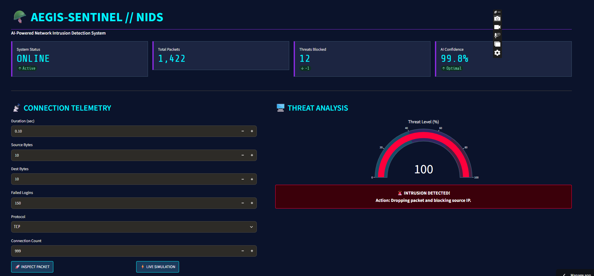
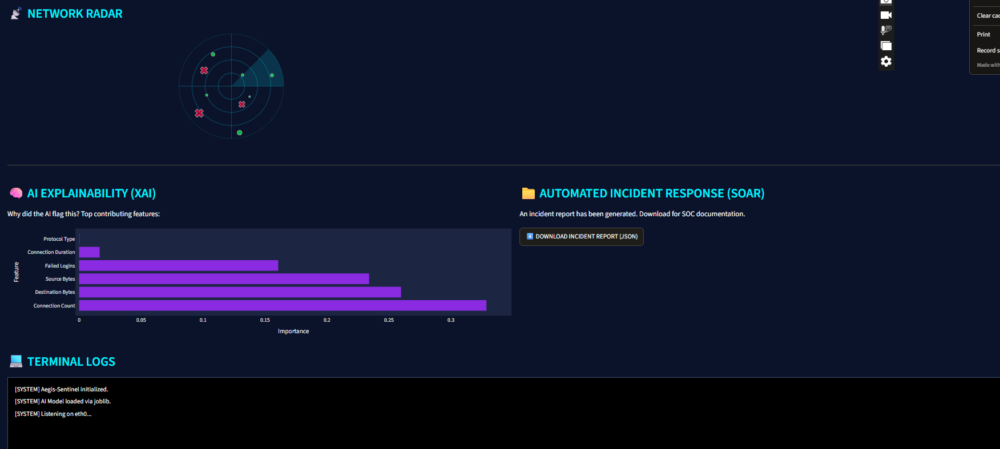
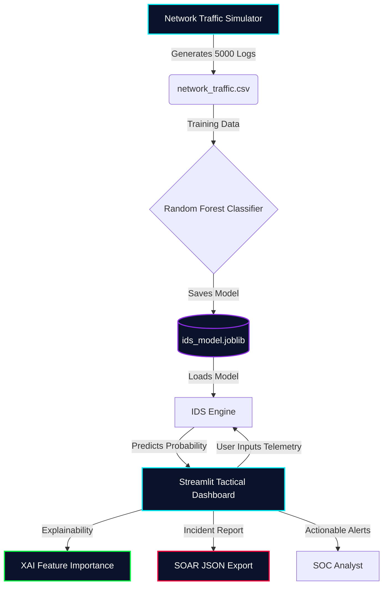

# 🪖 Aegis-Sentinel: AI-Powered Network Intrusion Detection System

[](TU_URL_DE_STREAMLIT_AQUI)
[](https://github.com/codewarrior777/aegis-sentinel)
[](https://github.com/codewarrior777/aegis-sentinel/actions/workflows/ci.yml)
[](https://github.com/codewarrior777/aegis-sentinel)
[](https://www.python.org/)
[]()
[]()

A next-generation Network Intrusion Detection System (NIDS) that uses Machine Learning to identify and classify cyber threats in real-time.

## 🌐 Try It Live

🔴 **[Open the Interactive Dashboard Here](TU_URL_DE_STREAMLIT_AQUI)**

No installation needed — just click and explore the tactical SOC dashboard in your browser.

## 📸 Tactical Dashboard Preview

### 1. AI Threat Detection & Network Radar


### 2. Explainable AI (XAI) & Automated Incident Response (SOAR)


## 🚨 The Problem & The Solution

- **The Problem:** Traditional firewalls rely on static rules and signatures. They cannot detect zero-day attacks, sophisticated brute-force attempts, or anomalous network behavior.
- **The Solution:** Aegis-Sentinel uses a **Random Forest Classifier** trained on network telemetry (connection duration, bytes transferred, failed logins, protocol type). It analyzes live network parameters and calculates a "Threat Level" probability, allowing SOC analysts to react instantly.

## 🧠 Core Features (God Level)

1. **Machine Learning Engine:** Uses Scikit-Learn's Random Forest algorithm to achieve high accuracy in detecting DDoS and Brute Force attacks.
2. **MLOps Persistence:** The trained AI model is saved to disk (`joblib`) to prevent unnecessary re-training on every app restart, saving compute resources.
3. **Automated Testing (QA):** Includes a `pytest` suite that validates the model's accuracy and ensures the API returns correct predictions.
4. **CI/CD Pipeline:** GitHub Actions workflow automatically runs tests on every push.
5. **Dockerized (DevOps):** Fully containerized environment. The app can be deployed on any cloud provider (AWS, GCP, Azure) using the provided `Dockerfile`.
6. **Explainable AI (XAI):** Visualizes feature importance to explain *why* the AI flagged a connection.
7. **SOAR (Incident Response):** Automatically generates a downloadable JSON incident report for SOC documentation.
8. **Tactical HUD:** A military-grade Streamlit dashboard with a real-time Gauge Chart, Network Radar, and live Terminal Logs.
9. **Live Simulation:** A built-in traffic generator that simulates real-time network monitoring and attack interception.

## 🏗️ System Architecture



## 📁 Project Structure

```text
aegis-sentinel/
├── .github/
│   └── workflows/
│       └── ci.yml             # CI/CD Pipeline (GitHub Actions)
├── assets/
│   ├── aegis_hud1.png         # Dashboard screenshot
│   └── aegis_hud2.png         # XAI & SOAR screenshot
├── src/
│   ├── data_generator.py      # Simulates normal and malicious network traffic
│   └── ids_engine.py          # Random Forest model & MLOps logic (joblib)
├── tests/
│   └── test_ids_engine.py     # Pytest suite (QA)
├── app.py                     # Streamlit tactical dashboard
├── Dockerfile                 # Container definition for deployment
├── requirements.txt           # Dependencies
└── README.md
```

## 🚀 How to Run Locally

### Option 1: Standard Python Environment

1. Clone the repository:
   ```bash
   git clone https://github.com/codewarrior777/aegis-sentinel.git
   cd aegis-sentinel
   ```

2. Create a virtual environment and install dependencies:
   ```bash
   python -m venv .venv
   .\.venv\Scripts\Activate.ps1  # Windows
   pip install -r requirements.txt
   ```

3. Generate the dataset and train the AI:
   ```bash
   python src/data_generator.py
   python src/ids_engine.py
   ```

4. **Run the Automated Tests:**
   ```bash
   pytest tests/ -v
   ```

5. Run the dashboard:
   ```bash
   streamlit run app.py
   ```

### Option 2: Docker Deployment

1. Build the Docker image:
   ```bash
   docker build -t aegis-sentinel .
   ```

2. Run the container:
   ```bash
   docker run -p 8501:8501 aegis-sentinel
   ```

3. Access the dashboard at `http://localhost:8501`.

## 🔒 Ethical Disclaimer
This tool is built for **educational and defensive cybersecurity purposes only**. The AI is trained on synthetic data. It should not be used as a replacement for enterprise-grade Intrusion Detection Systems.

---
*Built as an AI & Cybersecurity Portfolio Project by Gustavo Ramos.*