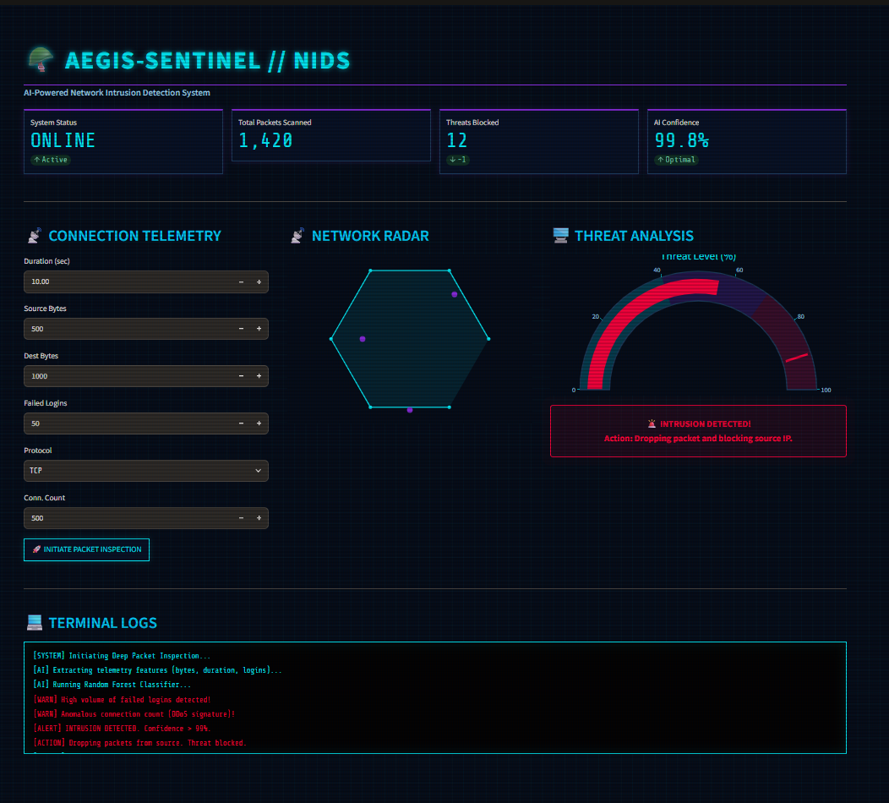
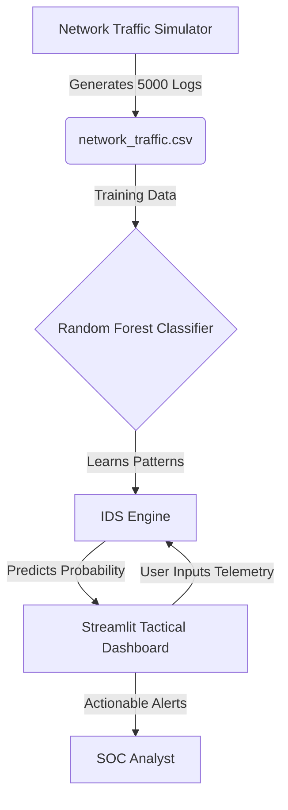

# 🪖 Aegis-Sentinel: AI-Powered Network Intrusion Detection System

[](https://aegis-sentinel-jypzprgmx9pgopmmygxseq.streamlit.app/)
[](https://aegis-sentinel-jypzprgmx9pgopmmygxseq.streamlit.app/)
[](https://www.python.org/)
[]()
[]()

A next-generation Network Intrusion Detection System (NIDS) that uses Machine Learning to identify and classify cyber threats in real-time.

## 🌐 Try It Live

🔴 **[Open the Interactive Dashboard Here](https://aegis-sentinel-jypzprgmx9pgopmmygxseq.streamlit.app/)**

No installation needed — just click and explore the tactical SOC dashboard in your browser.

## 📸 Tactical Dashboard Preview



## 🚨 The Problem & The Solution

- **The Problem:** Traditional firewalls rely on static rules and signatures. They cannot detect zero-day attacks, sophisticated brute-force attempts, or anomalous network behavior.
- **The Solution:** Aegis-Sentinel uses a **Random Forest Classifier** trained on network telemetry (connection duration, bytes transferred, failed logins, protocol type). It analyzes live network parameters and calculates a "Threat Level" probability, allowing SOC analysts to react instantly.

## 🧠 Core Features

1. **Synthetic Data Generator:** Includes a module to simulate thousands of network connections (normal vs. malicious) to train the model safely without needing real network traffic.
2. **AI Threat Engine:** Uses Scikit-Learn's Random Forest algorithm to achieve high accuracy in detecting DDoS and Brute Force attacks.
3. **Tactical HUD:** A military-grade Streamlit dashboard with a real-time Gauge Chart, Network Radar, and live Terminal Logs.
4. **Cloud-Ready:** Automatically generates the training dataset on startup if the CSV is missing.

## 🏗️ System Architecture



## 🚀 How to Run Locally

### Installation
1. Clone the repository:
   ```bash
   git clone https://github.com/codewarrior777/aegis-sentinel.git
   cd aegis-sentinel
   ```

2. Create a virtual environment and install dependencies:
   ```bash
   python -m venv .venv
   .\.venv\Scripts\Activate.ps1  # Windows
   pip install -r requirements.txt
   ```

3. Generate the dataset and train the AI:
   ```bash
   python src/data_generator.py
   python src/ids_engine.py
   ```

4. Run the dashboard:
   ```bash
   streamlit run app.py
   ```

## 🔒 Ethical Disclaimer
This tool is built for **educational and defensive cybersecurity purposes only**. The AI is trained on synthetic data. It should not be used as a replacement for enterprise-grade Intrusion Detection Systems.

---
*Built as an AI & Cybersecurity Portfolio Project by Gustavo Ramos.*